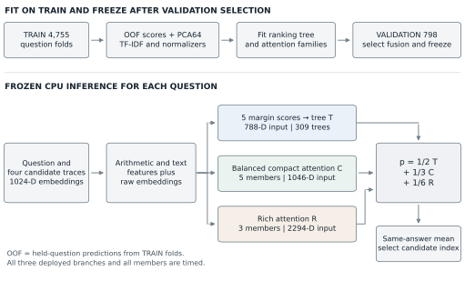

# DASE7506 MP2 v73 submission

The frozen method scores **402/467 = 86.0813704496788%** on the official test bank. All 467 choices agree on the local workstation and new-ser. Complete four-thread CPU prediction plus independent scoring takes **8.893 seconds** on new-ser's AMD EPYC 9354. All deployed inference files total **6,820,520 bytes = 6.5046 MiB**. Runtime on the reference Xeon Platinum 8457C has not been measured.

The [eight-page report](report/MP2_Report.pdf) includes the pipeline, training objectives, validation comparisons, fixed-weight ablations, validation examples, limitations, computation declaration and paper references. The pipeline is also available as [SVG](report/figures/pipeline.svg), [PDF](report/figures/pipeline.pdf) and [PNG](report/figures/pipeline.png).



## Package map

| Location | Purpose |
|---|---|
| `report/MP2_Report.pdf` | Submission report, eight A4 pages |
| `report/build_report.py` | Editable report text and figure-generation source |
| `report/data/` | Validation diagnostics, cases, CSV table and hardware record |
| `RESOURCE_DECLARATION.txt` | Training and evaluation resources, timing scope and asset accounting |
| `code/submission_v73.py` | Frozen prediction entry point; `submission.py` is an alias |
| `code/reference_rebuild_v73/` | Feature extraction, model fitting, NumPy inference and audits |
| `code/artifacts/v73/checkpoint/` | Every deployed inference asset |
| `code/artifacts/v73/` | Training plan, integrity manifest, source snapshot and experiment grid |
| `code/runs/v73-reference-study/` | Official scores, timings, audits and cross-host checks |
| `INFERENCE_ASSETS.json` | Complete deployed-asset inventory and hashes |
| `PACKAGE_MANIFEST.json` | All release file sizes and SHA-256 hashes, excluding itself |
| `guide/GUIDE.md` | Unmodified assignment guide |

The package contains the v73 method code and its matching frozen inference assets. Training search caches are generated by the training script when needed. Saved validation probabilities serve report diagnostics; prediction loads assets from `checkpoint/` only.

## Reproduce the official score

For complete benchmark reproduction, use **Linux x86_64**. From the package root, create a **Python 3.12** inference environment:

```bash
python3.12 -m venv .venv-inference
source .venv-inference/bin/activate
python -m pip install -r code/requirements-inference-v73.txt
python code/verify_release.py
cd code
python check_data.py
python -m reference_rebuild_v73.verify --run artifacts/v73 --split test --output runs/reproduced-test
```

Use a new output directory. The verifier checks frozen source, model and official-tool hashes, fixes the numerical backend and thread limit, and starts fresh official prediction and scoring processes sequentially. Its timing includes startup, loading, preprocessing and all selected members. Check the generated `test-score.json` and `test-benchmark.json`.

The original standalone new-ser reproduction is in `code/runs/v73-reference-study/clean-new-ser-test/`. Its total time is 8.893130 seconds; local reproduction is 3.439586 seconds. Both use Python 3.12 and NumPy 2.5.3. These are local hardware measurements rather than reference-Xeon certification.

To invoke the official tools directly from `code/`:

```bash
export OMP_NUM_THREADS=4 OPENBLAS_NUM_THREADS=4 MKL_NUM_THREADS=4 NUMEXPR_NUM_THREADS=4
export OPENBLAS_CORETYPE=Haswell
export NPY_DISABLE_CPU_FEATURES=X86_V4,AVX512_ICL,AVX512_SPR
python predict.py --method submission_v73.py --checkpoint artifacts/v73/checkpoint --split test --output runs/direct-test.json
python score_predictions.py --split test --predictions runs/direct-test.json --output runs/direct-score.json
```

The same frozen entry point accepts the official `audit` split and arbitrary input-bank IDs. No question ID is a model feature.

## Reproduce validation comparisons and resource checks

From `code/`, using the NumPy-only inference environment:

```bash
python report_analysis.py --output-dir ../report/recomputed-data
python -m reference_rebuild_v73.audit_runtime --run artifacts/v73 --output runs/recomputed-runtime-audit.json
python resource_audit.py --output runs/recomputed-resource-audit.json
python predict.py --method majority_baseline.py --split validation --output runs/majority-validation.json
python score_predictions.py --split validation --predictions runs/majority-validation.json --output runs/majority-validation-score.json
```

`report_analysis.py` reads TRAIN/validation references and saved validation component probabilities. It never reads TEST inputs or references, fits a model, changes the checkpoint or selects a replacement configuration. The report uses the 758/798 ensemble result, the majority baseline of 688/798 and four fixed ablations. Dropping the tree, balanced compact family, rich family or pooling yields 744, 753, 755 and 753 correct choices.

Those diagnostics were added after final test scoring and did not change the submitted method. Deletion renormalizes the remaining fixed weights without reoptimization. Validation was adaptively used during development. No component-level TEST results or TEST error examples are computed.

`resource_audit.py` measures a fresh validation predictor's OS thread count and loaded libraries; it is a diagnostic, not an official timing benchmark. It also verifies that NPZ entries are uncompressed and counts all arrays with FP16 expanded to FP32. The original diagnostic observed four threads, no child workers and no CUDA/Torch libraries; expanded arrays total 12,578,048 bytes, below 16 MiB.

## Reproduce training

Use a separate **Python 3.13** CUDA environment and one GPU no more powerful than an RTX 4090. The recorded run used one RTX 4090D. From the package root:

```bash
python3.13 -m venv .venv-train
source .venv-train/bin/activate
python -m pip install -r code/requirements-train-v73.txt
cd code
CUDA_VISIBLE_DEVICES=0 python -m reference_rebuild_v73.train --output artifacts/retrained-v73
python -m unittest test_reference_rebuild_v73 -v
python -m reference_rebuild_v73.audit_training --run artifacts/retrained-v73 --output runs/retrained-training-audit.json
```

All fitted parameters and statistics use supplied TRAIN. Validation controls the prescribed fusion search. The fitting code rejects TEST/audit reference requests. Original seeds, versions, fold memberships, loss histories and search choices are recorded. Retraining on another hardware/library stack is not guaranteed bitwise identical; use the frozen checkpoint for exact score reproduction.

The recorded v73 fit and selection took 212.74 seconds, with 388.13 MiB peak PyTorch allocated GPU memory. This measurement excludes environment setup, auditing and report production.

## Rebuild the report

Use a separate report environment; document-generation libraries are not inference dependencies:

```bash
python3.13 -m venv .venv-report
source .venv-report/bin/activate
python -m pip install -r report/requirements.txt
python report/build_report.py
```

Optional author fields are set with `--author "Name" --student-id "ID"`. The report intentionally has no invented name or student ID. All original figure assets and the numeric data used to build the tables are included. `report/build_report.py` reads aggregate experiment/diagnostic records and does not read TEST references.

## Method and AI assistance

The frozen v73 method combines a multi-view ranking and Logloss tree branch with balanced compact and rich candidate-attention families. Same-answer mean pooling selects one supplied candidate. The report describes the deployed components, training objectives, validation baselines, fixed-weight ablations and failure cases.

**OpenAI Codex substantially assisted implementation, experiments, diagnostics, figures and report drafting.** Report Section 8 discusses related work and AI assistance.

The configuration was selected on validation and frozen before test scoring. The test result should be interpreted as benchmark reproduction rather than an independent blind evaluation. The tree holdout uses a fixed OOF table and is not fully nested cross-validation of the complete pipeline.

The official parser, scorer and data are unchanged. Dataset licenses and notices are retained under `code/data/`. Inference uses no external data, additional pretrained weights, online API, answer lookup, or precomputed test prediction. The report bibliography contains papers; experimental records are supplied as evidence beside the code.
